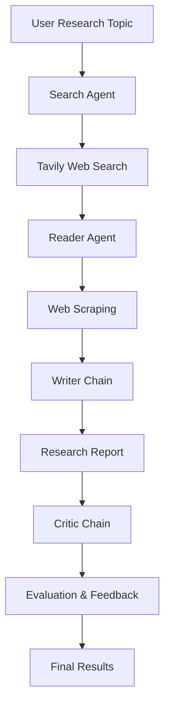

# 🔬 ResearchMind — Multi-Agent AI Research System

**ResearchMind** is an AI-powered multi-agent research system that automates the process of researching a topic, extracting relevant information from web sources, generating a structured research report, and evaluating the final output.

Built using **Python, LangChain, Mistral AI, Tavily, and Streamlit**, ResearchMind uses four specialized stages that collaborate to transform a simple research query into a detailed, professionally structured report.

---

## ✨ Key Features

- **🔍 Intelligent Web Research:** Searches the internet for recent and relevant information using the Tavily Search API.
- **📄 Automated Web Scraping:** Extracts meaningful content from selected web pages using BeautifulSoup and Requests.
- **✍️ AI-Powered Report Generation:** Generates structured research reports with introductions, key findings, conclusions, and source references.
- **🧐 AI Research Critic:** Evaluates generated reports, assigns a score out of 10, identifies strengths, and suggests improvements.
- **⚡ Multi-Agent Architecture:** Divides the research process into specialized agents and processing chains.
- **🖥️ Interactive Dashboard:** Provides a Streamlit-based interface with pipeline progress indicators and organized result panels.
- **📚 Source-Aware Research:** Incorporates search results and scraped content into the report-generation process.

---

## 🏗️ System Architecture

ResearchMind follows a sequential multi-agent architecture in which each stage performs a specialized task.



### Research Pipeline

| Stage | Component | Responsibility |
|---|---|---|
| 01 | Search Agent | Finds recent and relevant web information. |
| 02 | Reader Agent | Selects relevant URLs and extracts detailed webpage content. |
| 03 | Writer Chain | Generates a structured research report. |
| 04 | Critic Chain | Evaluates the report and provides constructive feedback. |

### How It Works

1. **Input:** The user enters a research topic through the command line or Streamlit interface.
2. **Research:** The Search Agent uses Tavily to discover relevant web sources.
3. **Extraction:** The Reader Agent identifies a relevant URL and retrieves its webpage content.
4. **Writing:** The Writer Chain combines search results and extracted content to generate a detailed report.
5. **Evaluation:** The Critic Chain reviews the generated report and provides a score, strengths, and areas for improvement.
6. **Output:** The system presents the research report and evaluation results.

---

## 🛠️ Tech Stack

| Technology | Purpose |
|---|---|
| Python | Core programming language |
| LangChain | Agent orchestration and LLM chains |
| LangGraph | Agent framework infrastructure |
| Mistral AI | Large Language Model integration |
| Tavily API | Web search and information retrieval |
| BeautifulSoup | HTML parsing and content extraction |
| Requests | HTTP requests and webpage retrieval |
| Streamlit | Interactive web application |
| Python-dotenv | Environment variable management |

---

## 📂 Project Structure

```text
ResearchMind/
│
├── agents.py           # Search Agent, Reader Agent,
│                       # Writer Chain and Critic Chain
│
├── tools.py            # Tavily web search and
│                       # webpage scraping tools
│
├── pipeline.py         # Main sequential research pipeline
│
├── app.py              # Streamlit user interface
│
├── requirements.txt    # Project dependencies
│
├── .env                # API credentials (not committed)
│
├── .gitignore          # Git ignored files
│
└── README.md           # Project documentation
```

---

## 🚀 Getting Started

Follow these steps to run ResearchMind locally.

### 1. Clone the Repository

```bash
git clone https://github.com/himanshuwalde/ResearchMind.git
```

```bash
cd ResearchMind
```

### 2. Create a Virtual Environment

```bash
python -m venv .venv
```

Activate the environment:

**Windows (PowerShell):**

```powershell
.venv\Scripts\Activate.ps1
```

**macOS / Linux:**

```bash
source .venv/bin/activate
```

### 3. Install Dependencies

```bash
pip install -r requirements.txt
```

### 4. Configure API Keys

ResearchMind requires API credentials from Mistral AI and Tavily.

Create a `.env` file in the project's root directory:

```env
MISTRAL_API_KEY=your_mistral_api_key
TAVILY_API_KEY=your_tavily_api_key
```

Obtain your API credentials:

- [Mistral AI Console](https://console.mistral.ai/)
- [Tavily](https://tavily.com/)

**Important:** Never commit your `.env` file or expose your API keys publicly.

---

## ▶️ Running the Application

ResearchMind supports two execution modes.

### Option 1: Streamlit Web Application (Recommended)

Launch the interactive dashboard:

```bash
streamlit run app.py
```

Open the local URL displayed in your terminal, usually:

```text
http://localhost:8501
```

Enter a research topic and click **Run Research Pipeline** to start the process.

### Option 2: Command-Line Execution

Run the research pipeline directly:

```bash
python pipeline.py
```

Enter your research topic when prompted:

```text
Enter a research topic: Artificial Intelligence in Healthcare
```

The system executes all four stages and displays the research report and critic feedback in the terminal.

---

## 📊 Generated Research Report

Each research report follows a structured format:

### 1. Introduction
Provides an overview and background of the research topic.

### 2. Key Findings
Presents at least three important findings based on the gathered research.

### 3. Conclusion
Summarizes the research and highlights important insights.

### 4. Sources
Lists the sources used during the research process.

### 5. Critic Evaluation
The Critic Chain provides:

- **Score:** Overall report evaluation out of 10.
- **Strengths:** Positive aspects of the generated report.
- **Areas to Improve:** Identified weaknesses and improvement opportunities.
- **Verdict:** A concise overall assessment.

---

## 🔐 Environment Variables

| Variable | Description |
|---|---|
| `MISTRAL_API_KEY` | API key for accessing Mistral AI models. |
| `TAVILY_API_KEY` | API key for Tavily web search. |

---

## 🎯 Project Objectives

- Explore practical applications of multi-agent AI systems.
- Automate web-based research and information extraction.
- Generate structured reports using large language models.
- Implement AI-based content evaluation and feedback.
- Understand agent orchestration and tool integration using LangChain.

---

## 🔮 Future Enhancements

- Implement iterative research and report refinement based on critic feedback.
- Introduce multiple reader agents for parallel source extraction.
- Add source credibility and factual consistency verification.
- Enable downloadable research reports in PDF and DOCX formats.
- Integrate citation management and reference formatting.
- Introduce persistent research history and user sessions.
- Explore parallel multi-agent execution and advanced orchestration.

---

## 👨‍💻 Author

**Himanshu Walde**

Computer Science & Engineering | AI & Machine Learning

- GitHub: [@himanshuwalde](https://github.com/himanshuwalde)
- LinkedIn: [Himanshu Walde](https://www.linkedin.com/in/himanshu-walde-20b716290/)

---

## 📄 License

This project is developed for educational and research purposes.

---

**If you find ResearchMind interesting, consider giving the repository a ⭐!**